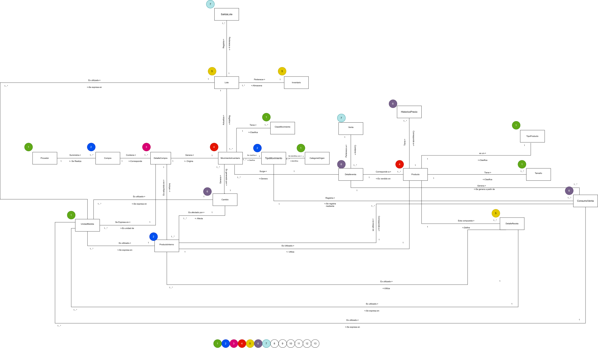

# Modelo de dominio

[Inicio](../../README.md) · [Diagrama de clases](../02-diagrama-clases/README.md) · [Modelo entidad-relación](../03-modelo-entidad-relacion/README.md)

Modelo de dominio del sistema de inventario de la pizzería: objetos de dominio, su línea de vida, reglas de negocio y, para cada objeto, su muestreo, caracterización, eventos y políticas.

## Diagrama (línea de vida)

> Haz clic en la imagen para verla en tamaño completo. También disponible en [PNG](../../assets/diagramas/modelo-dominio.png).

Los números en círculos de colores indican la **línea de vida**: el orden en que cada objeto puede crearse según los objetos de los que depende.

## Objetos de dominio

| Objeto | Descripción | Línea de vida |
|---|---|:---:|
| [Proveedor](objetos/Proveedor.md) | Son las personas o empresas que le venden a la pizzería los insumos que necesita para funcionar. | 1 |
| [UnidadMedida](objetos/UnidadMedida.md) | Es la unidad con la que se mide cada ingrediente o producto, por ejemplo kilos, litros o unidades. | 1 |
| [TipoProducto](objetos/TipoProducto.md) | Indica en qué categoría entra cada producto que vende la pizzería, por ejemplo si es una pizza, una bebida o una adición. | 1 |
| [ClaseMovimiento](objetos/ClaseMovimiento.md) | Indica si un movimiento de inventario fue una entrada o una salida de insumos o productos. | 1 |
| [Tamaño](objetos/Tamano.md) | Son los distintos tamaños en los que la pizzería puede ofrecer una pizza. | 1 |
| [CategoriaOrigen](objetos/CategoriaOrigen.md) | Indica qué operación fue la que generó un movimiento de inventario: una compra, una venta, un cambio de un producto que no es perecedero, o el retiro de un lote (porque se cambió o porque se venció). | 1 |
| [Usuario](objetos/Usuario.md) | Es la persona que puede ingresar a la aplicacion; solo el administrador de la pizzeria puede iniciar sesion. | 1 |
| [Compra](objetos/Compra.md) | Es cuando la pizzería le compra insumos o productos a un proveedor. | 2 |
| [ProductoInterno](objetos/ProductoInterno.md) | Es cada insumo o producto que la pizzería compra y guarda en su inventario, sin importar si se usa para preparar algo o si se vende directamente al cliente. | 2 |
| [TipoMovimiento](objetos/TipoMovimiento.md) | Es el código de una operación concreta que mueve el inventario (cada detalle de compra, consumo de una venta o cambio tiene el suyo). Pertenece a una CategoriaOrigen y lo comparten la operación y los movimientos que genera. | 2 |
| [DetalleCompra](objetos/DetalleCompra.md) | Es cada uno de los productos o insumos que se compraron en una compra, con la cantidad de cada uno. | 3 |
| [Producto](objetos/Producto.md) | Son los productos que la pizzería vende, como las pizzas, las bebidas y las adiciones. | 4 |
| [Venta](objetos/Venta.md) | Es cuando un cliente compra productos en la pizzería. | 4 |
| [MovimientoInventario](objetos/MovimientoInventario.md) | Es cada entrada o salida concreta de un lote, registrada en una fecha (FechaMovimiento). Lo genera una operación (TipoMovimiento), indica si suma o resta (ClaseMovimiento) y por el lote se sabe qué producto interno se movió. Si una operación usa varios lotes (FIFO), genera un movimiento por cada lote. | 4 |
| [HistoricoPrecio](objetos/HistoricoPrecio.md) | Aquí se guarda el registro de los precios que ha tenido cada producto a lo largo del tiempo, para poder ver cómo han cambiado. | 5 |
| [DetalleVenta](objetos/DetalleVenta.md) | Es cada uno de los productos que se vendieron en una venta, con la cantidad y el valor de cada uno. | 5 |
| [DetalleReceta](objetos/DetalleReceta.md) | Es cada uno de los ingredientes que se necesitan para preparar una receta, con la cantidad que se necesita de cada uno. | 5 |
| [Cambio](objetos/Cambio.md) | Es cuando se retira un insumo que ya casi se vence y se cambia por otro que sí sirve, para que la pizzería siempre tenga insumos en buen estado. | 5 |
| [Lote](objetos/Lote.md) | Es un grupo de unidades de un mismo insumo que llegó en una compra, y que se identifica para saber cuánto hay, cuándo llegó y poder rastrearlo dentro del inventario. | 6 |
| [ConsumoVenta](objetos/ConsumoVenta.md) | Son los productos internos que se deben consumir por cada detalle de venta, según la receta del producto vendido. Cada consumo tiene su propio TipoMovimiento. | 6 |
| [Inventario](objetos/Inventario.md) | Es la cantidad que hay disponible de cada insumo o producto que la pizzería necesita para trabajar y vender. | 7 |
| [SalidaLote](objetos/SalidaLote.md) | SalidaLote representa el retiro efectivo de una cantidad de producto perteneciente a un lote, realizado por el usuario después de atender una alerta de proximidad al vencimiento. Atributos: Id, Lote, Cantidad y FechaMovimiento. Relación: Lote 1 — 0..1 SalidaLote (un lote puede tener como máximo un retiro; cada retiro pertenece a un único lote). La alerta no se almacena aquí: se calcula a partir de Lote.FechaVencimiento. | 7 |

Cada objeto tiene una página con cuatro secciones: **Muestreo** (atributos y datos de ejemplo), **Caracterización** (reglas de cada atributo y responsabilidades), **Eventos** (Event Storming) y **Políticas** (reglas de negocio que debe asegurar).

## Reglas de negocio

1. Cada pizzería administra un inventario independiente.
2. Todo cambio en las existencias de los productos internos debe quedar registrado: las entradas y salidas por compra, venta y cambio mediante un MovimientoInventario, y los retiros por vencimiento mediante una SalidaLote.
3. El inventario debe reflejar automáticamente los movimientos y retiros registrados (actualizaciones).
4. Cada pizza y cada adición posee una única receta. Las bebidas no tienen receta, porque se venden directamente del inventario.
5. Una venta puede tener muchos productos, cada uno registrado en un DetalleVenta. El total de la venta se calcula como la suma de los subtotales de sus detalles y, con base en él, se emite la factura y se realiza el pago.
6. Todo se paga de contado, para no manejar sistemas de crédito con los proveedores.
7. No se maneja nómina: el sistema no registra empleados ni sueldos. Solo existe el usuario Administrador, que es quien ingresa a la aplicación.
8. El precio de un producto puede cambiarse cuando sea necesario; cada cambio queda registrado en HistoricoPrecio.
9. Cada instancia del sistema corresponde a una sola pizzería, y la información operativa pertenece exclusivamente a la pizzería que utiliza dicha instancia.
10. El valor total de una compra corresponde a la suma de los precios de compra de todos sus detalles de compra, y no puede superar 5.000.000.
11. Solo los usuarios activos con rol Administrador pueden ingresar a la aplicación.
12. La unidad de medida de cada ingrediente de una receta se asigna automáticamente según el tipo de medida del producto interno: Peso = g, Volumen = ml, Unidad = und.
13. Los proveedores, los productos y los productos internos no se eliminan: se retiran o inactivan, para conservar su historial de compras, ventas, recetas y precios.
14. Un producto solo puede tener un precio vigente, que se identifica con la FechaFin 01/01/1000. Al registrar un nuevo precio, el anterior se cierra.
15. Los productos que se venden directo del inventario (por ejemplo las bebidas) deben tener un producto interno con el mismo nombre; los demás productos se asocian al registro "Sin insumo".
16. Cada producto interno tiene un único registro de inventario, que se crea al registrar el producto interno.
17. La fecha de vencimiento de un lote es la fecha de compra más la vida útil si el producto es perecedero; si no lo es, es la fecha de vencimiento que trae el producto.
18. Si no se indica el cliente de una venta, se registra 2222222222 (consumidor final).
19. El número de factura de venta (FV- seguido de 6 dígitos) se asigna de forma consecutiva al confirmar la venta.
20. Las existencias se validan al confirmar la venta, no al agregar productos al detalle. Una venta confirmada no se puede modificar ni eliminar.
21. Al confirmar una venta, los productos internos consumidos salen del inventario por FIFO: primero del lote más antiguo con saldo disponible.
22. Cuando un lote está próximo a vencer: si el producto es no perecedero se cambia con el proveedor (Cambio); si es perecedero no se cambia, se retira del lote con una SalidaLote.

## Categorías de colores

En el archivo Excel original (hojas de muestreo) se usan colores para identificar:

- Descripciones
- Id's
- combinacion unica
- objeto
- Tipo de dato
- Si es obligatorio o no el atributo
- Calculado
